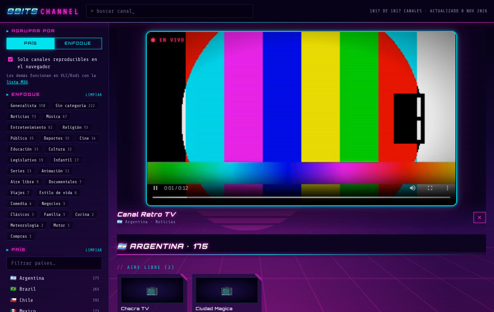

# 📺 8bits Channel — Visor IPTV

Visor web de los canales públicos de [iptv-org/iptv](https://github.com/iptv-org/iptv),
**ordenados por país y por enfoque (categoría)**, que **elimina automáticamente los
canales no accesibles**.



Estética retrofuturista (synthwave): neón magenta y cian, sol de líneas y
rejilla en perspectiva (estáticos, ligeros para TV Box) y tipografías Orbitron,
Share Tech Mono y VT323. Las animaciones se desactivan si el sistema pide
«reducir movimiento».

## Cómo funciona

1. **Verificación en el servidor** (`scripts/build.mjs`): descarga los datos de la
   [API de iptv-org](https://github.com/iptv-org/api) (canales, streams, países,
   categorías y logos) y comprueba cada stream:
   - responde con HTTP 2xx (enviando el `User-Agent`/`Referer` que exige cada stream),
   - el contenido es realmente una lista `#EXTM3U`,
   - si es una lista maestra, su primera variante también responde,
   - si tiene cabecera CORS (necesaria para reproducirse en el navegador).

   Todo lo que falla se descarta. El resultado es `public/data/channels.json`
   y una lista `public/data/playlist.m3u` (solo canales que funcionan) para VLC/Kodi.
   Se excluyen canales para adultos y canales cerrados.

2. **Eliminación en el navegador** (`public/app.js`): si al reproducir un stream
   falla (error de red, manifiesto inválido o 20 s sin arrancar), se marca como roto,
   se prueba automáticamente la siguiente fuente del canal y, si no queda ninguna,
   el canal desaparece de la lista. Se recuerda 3 días en `localStorage` (y se puede
   restaurar desde la barra lateral). Si estás sin conexión no se elimina nada.

3. **GitHub Actions** (`.github/workflows/update.yml`): repite la verificación
   todos los días y publica el visor en GitHub Pages.

## Funciones del visor

- Agrupar por **país** (subgrupos por enfoque) o por **enfoque** (subgrupos por país).
- Filtros por país y por una o varias categorías, con contadores; búsqueda por nombre.
- «Solo canales reproducibles en el navegador»: oculta streams sin CORS, `http://`
  (bloqueados en páginas https), DASH o que necesitan cabeceras especiales.
  Desactívalo para verlos y abrirlos en un reproductor externo.
- Selector de fuente cuando un canal tiene varias, logos y calidad.
- **Zapping como en una TV**: cada canal tiene número fijo (001, 002…).
  - Mando / teclado: **CH+ / CH−** (o Re Pág / Av Pág), flechas **▲ ▼** en
    pantalla completa o con el foco en el vídeo, **números** para ir a un canal,
    **i** / OK para ver el rótulo, **F** para pantalla completa.
  - Móvil: botones **CH▲ / CH▼** o deslizar arriba/abajo sobre el vídeo.
  - Al cambiar aparece el rótulo con número, nombre y país. Si un canal no
    tiene señal se elimina y salta solo al siguiente, en la misma dirección.
  - Al abrir (web y app) se pone el último canal visto.
- **Favoritos**: botón ☆ en el reproductor (o tecla `*` del mando). Salen
  arriba en «★ Favoritos» y con «Solo mis favoritos» el zapping va solo por ellos.
- Sonido: en la app la TV reproduce con sonido sin tocar la pantalla. Si un
  navegador bloquea el sonido automático, aparece «🔇 Activar sonido» y se
  activa con cualquier tecla o toque.
- Diseño adaptable a móvil.

## 📱 App Android (APK)

El mismo visor empaquetado como app nativa con [Capacitor](https://capacitorjs.com/)
(carpeta `android/`). Funciona en móviles, tablets y **Android TV / TV Box**
(se maneja con el mando y aparece en el lanzador de la TV).

**Descargar:** [última APK](../../releases/latest/download/8bits-channel.apk)
(o en *Releases*). Ábrela en el Android y permite «instalar apps desconocidas».

Diferencias con la web:
- La lista de canales se descarga de la web publicada (actualizada cada día);
  la APK lleva una copia de respaldo.
- Reproduce también streams `http://` (en la web los bloquea el navegador).
- El botón «atrás» cierra el menú o el reproductor antes de salir.

El workflow `.github/workflows/android.yml` compila la APK en cada cambio y,
en `main`, la publica en *Releases*.

Firma: sin configurar nada, la APK se firma con una clave de depuración
(funciona, pero al actualizar puede pedir desinstalar la anterior). Para una
firma fija, crea una clave y guárdala en *Settings → Secrets and variables →
Actions* como `ANDROID_KEYSTORE_BASE64` (el archivo .keystore en base64),
`ANDROID_KEYSTORE_PASSWORD` y `ANDROID_KEY_ALIAS`. Nunca subas la clave al
repositorio.

Compilar en local (requiere Android SDK y JDK 21):

```bash
npm ci && npx cap sync android && (cd android && ./gradlew assembleRelease)
```

## Publicarlo en GitHub Pages

1. Fusiona esta rama en `main`.
2. En **Settings → Pages → Build and deployment → Source**, elige **GitHub Actions**.
3. En **Actions → Verificar canales y publicar**, pulsa **Run workflow**
   (después se ejecuta solo cada día). La verificación completa tarda entre
   15 y 60 minutos.

## Uso local

```bash
npm run build        # verifica todos los streams (lento)
npm run build:quick  # sin verificar, solo para probar la interfaz
npm run serve        # http://localhost:8080
npm test
```

Opciones de `scripts/build.mjs`: `--limit N`, `--concurrency N`, `--timeout MS`,
`--iptv-dir RUTA` (clon de iptv-org/iptv para asignar país a streams sin canal),
`--no-check`, `--min-working N` (aborta si funcionan menos de N streams, por defecto 500,
para no publicar un visor vacío si falla la red).

## Aviso

Este proyecto no aloja ningún stream: solo enlaza a las URLs públicas recopiladas por
iptv-org. La disponibilidad depende de cada emisora (algunos canales tienen bloqueo
geográfico).
